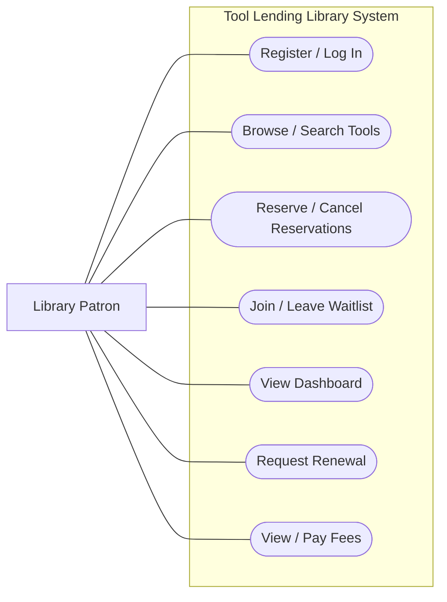
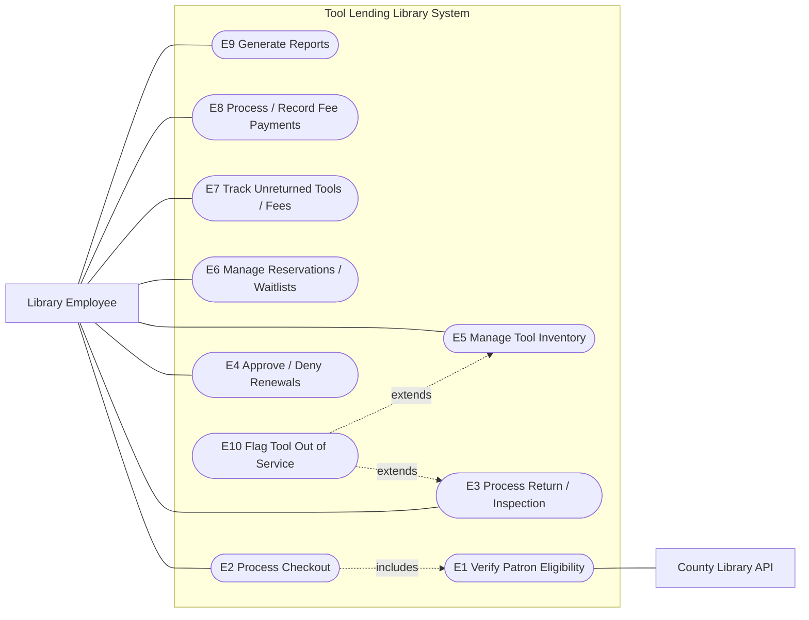
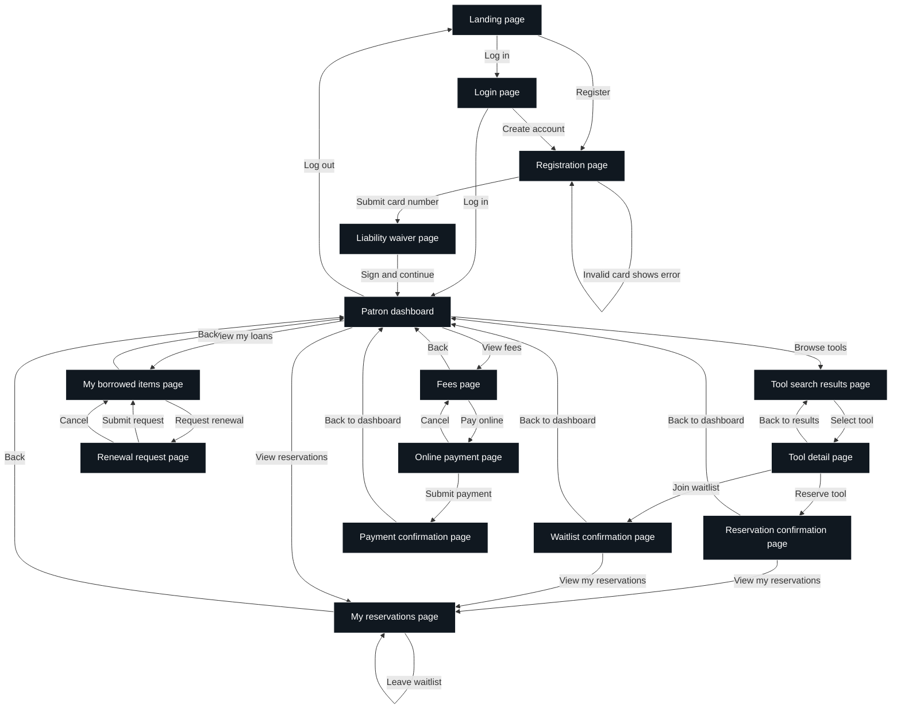
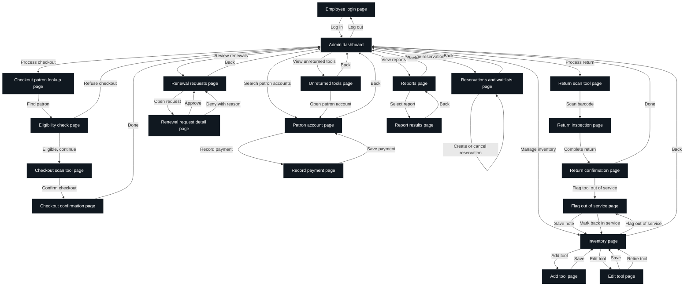

# Tool Lending Library Functional Specification

**Team Members:** Dakota Rentz, Brendan Bessman, Zach Yarvis, Benny Garcia

## 1. Overview

The Tool Lending Library is a web-based application designed to support a new tool-lending service operated by the county library at a separate location. The system will allow eligible library patrons to browse available tools, manage reservations, track their borrowed items, and view and pay outstanding fees.

Patrons must be at least 18 years old, have their own valid county library card, register a new account, and complete an electronic liability waiver before borrowing tools. The system will use the county library's existing API to validate library cards and retrieve borrower metadata, while library employees will verify patron age using identification at checkout. Patrons may borrow up to five tools at a time, with an initial checkout period of up to two weeks and one optional renewal for the original checkout duration. Renewals are not permitted when another patron is on the tool's waitlist.

Library employees will use the system to verify borrower eligibility, process checkouts and returns, manage tool inventory, document maintenance issues, process in-person fee payments, and generate reports. Each physical tool will have a unique internal identifier and barcode for tracking purposes.

The system will also support tool waitlists, overdue fees, borrowing restrictions, and online payments. It will integrate with the county library's existing card-validation API while maintaining a separate website and inventory system for the Tool Lending Library. Patrons will have access to a personal dashboard displaying borrowing history, loan status, remaining days, reservations, and outstanding fees.

## 2. User Scenarios

### Scenario 1: Patron Registration

Sarah is a county library patron who wants to borrow tools for a home improvement project. She visits the Tool Lending Library website and creates an account using her valid county library card. The system verifies her card and retrieves borrower metadata through the county library's existing API. Sarah completes the electronic liability waiver and gains access to her personal dashboard, where she can view her borrowing history, loan status, remaining days, reservations, and outstanding fees.

### Scenario 2: Browsing and Reserving a Tool

Mike needs a power drill for a weekend project. He logs into the Tool Lending Library website and searches for available drills. After finding one, he reserves it through the website. The system places the drill on hold for three days and sends Mike a confirmation email with the pickup deadline. His reservation also appears on his dashboard.

### Scenario 3: Checking Out a Tool

David arrives at the Tool Lending Library to pick up a reserved circular saw. A library employee verifies his library card and confirms he is at least 18 years old by checking his identification. The employee scans the tool's barcode and processes the checkout. The system records the borrower, checkout date, and due date, and updates the tool's status to checked out. David can now view the borrowed tool and its return deadline on his dashboard.

### Scenario 4: Requesting a Renewal

Jessica has borrowed a pressure washer but needs additional time to finish her project. She logs into her dashboard and submits a renewal request. A library employee reviews the request through the administrative dashboard and confirms that Jessica has not previously renewed the tool and that no other patrons are on its waitlist. The employee approves the request, and the system extends the due date by the original checkout duration and notifies Jessica by email. If another patron is waiting, the renewal is denied.

### Scenario 5: Returning a Tool

James returns a borrowed electric sander to the Tool Lending Library. A library employee scans the tool's barcode and inspects its condition. After confirming the tool is in good working order, the employee completes the return in the system. The tool's status is updated, and James's borrowing record reflects the completed return.

### Scenario 6: Managing Overdue Tools

Emily forgets to return a borrowed ladder by its due date. The system sends her an email reminder on the due date and daily overdue reminders afterward. Once the due date passes, the system marks the tool as unreturned and displays its overdue status on Emily's dashboard along with any applicable fees. Late fees follow the library's established fee schedule and cap, including for unreturned tools. Emily can pay her outstanding fees online through her dashboard or visit the library to make a payment with an employee. The system records the payment and updates her outstanding balance. A library employee can also view the overdue checkout and payment status through the administrative dashboard.

### Scenario 7: Managing Tool Inventory

A library employee receives several new tools for the library. The employee logs into the administrative dashboard and adds each tool to the inventory with its name, category, unique identifier, and barcode. The employee can also update tool information, flag damaged tools for maintenance, and retire tools that are no longer suitable for lending. Tools currently checked out cannot be retired until they are returned.

### Scenario 8: Joining a Tool Waitlist

Alex wants to borrow a table saw, but all available units are currently checked out or reserved. He joins the waitlist through the website. When a tool becomes available for him, the system notifies Alex and provides a three-day pickup window. If Alex does not pick up the tool within that period, the system releases the hold and advances to the next eligible patron on the waitlist.

### Scenario 9: Generating Reports

A library employee wants to review the Tool Lending Library's borrowing activity and inventory status. The employee logs into the administrative dashboard and accesses the reporting section. The system generates reports showing currently checked-out tools, overdue tools, tools undergoing maintenance, and the most frequently borrowed tools. The employee uses this information to monitor inventory, identify overdue items, and evaluate tool demand.

### Scenario 10: Processing In-Person Fee Payments

Robert visits the Tool Lending Library to pay an outstanding overdue fee. A library employee accesses Robert's account through the administrative dashboard and reviews his outstanding balance. The employee processes or records Robert's payment, and the system updates his balance and saves the transaction in his payment history. Robert can view the updated balance through his personal dashboard.

## 3. Non-Goals

The following features are outside the scope of the Tool Lending Library application:

1. **Tool Delivery Services:** The system will not support shipping, home delivery, or off-site pickup. Patrons must visit the Tool Lending Library's physical location to pick up and return tools.

2. **Tool Sales and Purchasing:** The system will not support selling tools to patrons or purchasing replacement tools. It is intended for tool lending and inventory management only.

3. **Educational and Training Services:** The system will not provide tool-use classes, instructional videos, or certification courses.

4. **Native Mobile Applications:** The project will not include separate iOS or Android applications. Instead, the website will be mobile-friendly and accessible through web browsers.

5. **Multiple Library Locations:** The system will support one Tool Lending Library location and will not include multi-branch inventory management or tool transfers between locations.

6. **Self-Service Checkout:** Patrons will not be able to check out tools independently. All checkouts must be processed by authorized library employees.

7. **Separate Employee Permission Levels:** The system will not distinguish between different employee roles or administrative permission levels. All authorized library employees will have the same administrative access.

8. **Replacing the County Library's Existing System:** The Tool Lending Library will operate as a separate application and will not replace the county library's existing library management system. It will integrate with the existing library-card validation API.

9. **Dedicated Kiosk Application:** The system will not include a separate kiosk application. Patrons may access the Tool Lending Library website using library-provided computers or their own devices.

## 4. Use-Case Diagrams

The following diagrams illustrate the primary interactions between users and the Tool Lending Library system. The system has two user roles: Library Patrons and Library Employees. All library employees have the same administrative permissions.

### Library Patron Use-Case Diagram

This diagram shows the functions available to library patrons, including account registration, searching for tools, managing reservations and waitlists, viewing borrowing information, requesting renewals, and paying outstanding fees.

### Library Employee Use-Case Diagram

This diagram shows the functions available to library employees: processing checkouts and returns, approving renewals, managing inventory, reservations, and waitlists, tracking unreturned tools and fees, recording payments, and generating reports. Checkout always includes verifying patron eligibility, which uses the county library's existing API to validate the patron's library card. Flagging a tool as out of service is a separate action that an employee can take during a return or while managing inventory. All library employees have the same administrative permissions.

## Library Employee Use Cases
 
 
| ID | Use case | Relationship |
|---|---|---|
| E1 | Verify Patron Eligibility | Included by E2. Uses the County Library API. |
| E2 | Process Checkout | Includes E1. |
| E3 | Process Return / Inspection | Extended by E10. |
| E4 | Approve / Deny Renewals | |
| E5 | Manage Tool Inventory | Extended by E10. |
| E6 | Manage Reservations / Waitlists | |
| E7 | Track Unreturned Tools / Fees | |
| E8 | Process / Record Fee Payments | |
| E9 | Generate Reports | |
| E10 | Flag Tool Out of Service | Extends E3 and E5. |
 
### E1 Verify Patron Eligibility
 
- **Actors:** Employee, County Library API
- **Included by:** E2
- **Precondition:** The patron is present with their library card and ID.
- **Main flow:** Employee confirms all of the following:
  1. The library card is valid (County Library API).
  2. The patron has an account and a signed liability waiver.
  3. The patron's ID shows they are 18 or older.
  4. The patron has fewer than 5 tools checked out.
  5. The patron has no unreturned tools.
- **Alternate flow:** Any check fails: the employee refuses the checkout.
- **Postcondition:** The patron is eligible or refused.
### E2 Process Checkout
 
- **Actor:** Employee
- **Includes:** E1
- **Precondition:** The patron is present with their library card and ID.
- **Main flow:**
  1. Employee finds the patron and performs E1.
  2. Employee scans the tool's barcode.
  3. Employee sets the due date, at most 14 days out.
  4. System records the borrower, checkout date, and due date, and marks the tool Checked Out.
  5. If the patron held a reservation for this tool type, the system marks it fulfilled.
- **Alternate flows:**
  - E1 fails: the checkout is refused.
  - Tool is Out of Service, or on hold for another patron: the system rejects the scan.
  - Tool is a kit: it counts as one tool toward the 5-tool limit.
- **Postcondition:** The loan and due date appear on the patron's dashboard.
### E3 Process Return / Inspection
 
- **Actor:** Employee
- **Extended by:** E10
- **Precondition:** The tool is checked out.
- **Main flow:**
  1. Employee scans the tool's barcode.
  2. Employee inspects the tool. For a kit, the employee checks every component against the kit's inventory label.
  3. Tool is in good condition: the employee completes the return, and the tool becomes Available.
  4. If the return is late, accrued fees stay on the patron's account.
- **Alternate flows:**
  - Tool is damaged or has missing parts: the employee completes the return and performs E10.
  - Simple consumables are used up: the employee replaces them. Repairs go to tech staff, outside this system.
  - Tool was Unreturned: the return still completes. Fees stay on the account.
- **Postcondition:** The loan is Returned. If the tool is Available and a waitlist exists, the front patron's 3-day hold starts.
### E4 Approve / Deny Renewals
 
- **Actor:** Employee
- **Precondition:** A patron has submitted a renewal request.
- **Main flow:**
  1. Employee opens the pending request.
  2. Employee confirms the loan has not been renewed and no patron is on the waitlist for the tool.
  3. Employee approves. The due date extends by the original checkout period and the patron is emailed.
- **Alternate flow:** Employee denies the request, with a reason. The patron is emailed.
- **Postcondition:** The loan has a new due date, or is unchanged.
### E5 Manage Tool Inventory
 
- **Actor:** Employee
- **Extended by:** E10
- **Main flow (add tools):**
  1. Employee opens the inventory section of the administrative dashboard.
  2. Employee enters the tool's name, category, fee class, replacement value, and whether it is a kit.
  3. Employee enters each unit's unique internal ID and barcode.
  4. System adds the tools as Available.
- **Alternate flows:**
  - Update: employee edits a tool's information.
  - Flag for maintenance: employee performs E10.
  - Retire: employee retires a tool that is no longer suitable for lending. A checked-out tool cannot be retired until it is returned.
- **Postcondition:** The inventory reflects the change.
### E6 Manage Reservations / Waitlists
 
- **Actor:** Employee
- **Main flow:**
  1. Employee opens the waitlist for a tool type.
  2. At a patron's request, employee creates a reservation or cancels one on their behalf.
- **Postcondition:** The waitlist and the patron's dashboard are updated.
### E7 Track Unreturned Tools / Fees
 
- **Actor:** Employee
- **Main flow:**
  1. Employee opens the unreturned-tools view in the administrative dashboard.
  2. System shows each unreturned loan with patron, due date, and accrued fee.
- **System behavior:**
  - A loan becomes Unreturned as soon as its due date passes.
  - The patron is emailed a reminder on the due date and every day after.
  - The patron cannot check out more tools until the situation is resolved.
  - Fees begin after a grace period (through closing on the next open day): $1 per day for standard tools, $3 per day for high-demand or large tools. The fee per loan never exceeds the lower of the tool's replacement value or $20.
- **Postcondition:** None.
### E8 Process / Record Fee Payments
 
- **Actor:** Employee
- **Precondition:** The patron is present and owes a balance.
- **Main flow:**
  1. Employee opens the patron's account and reviews the balance.
  2. Employee processes or records the payment.
  3. System updates the balance and saves the transaction in the payment history.
- **Postcondition:** The patron sees the updated balance on their dashboard.
### E9 Generate Reports
 
- **Actor:** Employee
- **Main flow:**
  1. Employee opens the reporting section of the administrative dashboard.
  2. Employee selects a report.
  3. System generates it.
| Report | Contents |
|---|---|
| Currently checked out | All active loans |
| Overdue | All unreturned loans |
| In repair | All Out of Service tools, with notes |
| Most borrowed | Tool types ranked by number of loans |
 
### E10 Flag Tool Out of Service
 
- **Actor:** Employee
- **Extends:** E3 (during a return) and E5 (while managing inventory)
- **Precondition:** The tool is not checked out. During a return, the return completes first.
- **Main flow:**
  1. Employee selects the tool.
  2. Employee describes what needs to be done (for example broken, damaged, or missing parts).
  3. Employee marks the tool Out of Service.
  4. System saves the note and removes the tool from lending.
- **Alternate flows:**
  - Return to service: after staff finish the work, the employee marks the tool in service and it becomes Available.
  - Tool has waitlisted patrons: the waitlist is unchanged. Holds start only when a tool is in service and available.
- **Postcondition:** The tool appears in the In repair report until it is marked in service.

## UX Flows
### Patreon Site

### Employee Site
